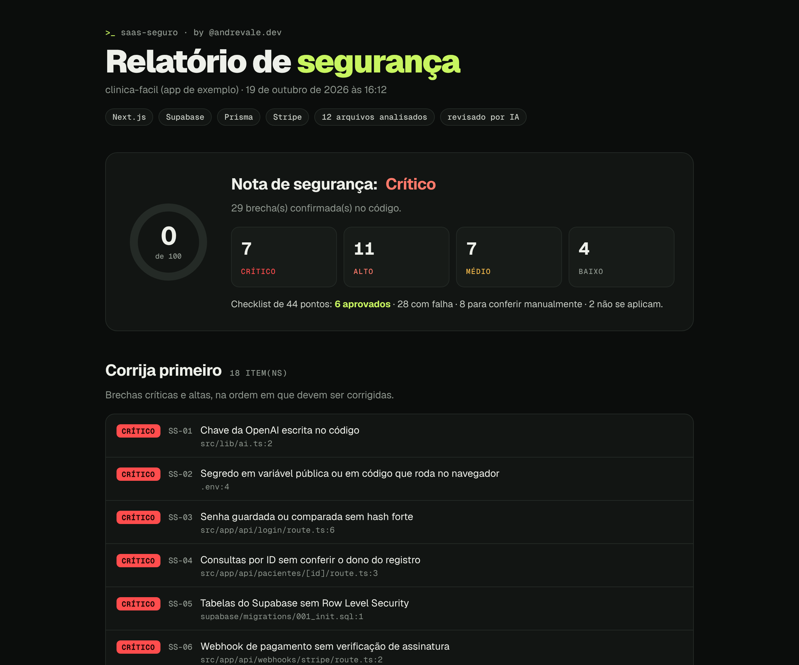

# saas-seguro · varredura de segurança para quem faz SaaS com IA

Uma skill gratuita para o **Claude Code** e o **Codex** que entra no seu projeto, procura as brechas de segurança mais comuns em apps feitos com vibe coding e entrega um **relatório em PDF e HTML** com o passo a passo para corrigir cada uma.

Feita por [@andrevale.dev](https://instagram.com/andrevale.dev).



---

## Por que isso existe

Nunca foi tão fácil colocar um SaaS no ar. Com o Claude Code, o Codex, o Cursor ou o Lovable, muita gente que nunca programou está lançando produto em um fim de semana. Isso é ótimo.

O problema é que a IA escreve código que **funciona**, não código que está **seguro**. Ela cola a chave da API direto no arquivo, esquece de conferir se o paciente pertence à clínica logada, deixa o webhook de pagamento aceitar qualquer requisição. O app roda, o cliente usa, e o problema só aparece quando alguém de fora encontra.

Esta skill faz a revisão que um dev sênior faria antes do deploy, e te diz exatamente o que corrigir.

---

## ⚠️ Instale dentro do projeto que você quer analisar

A skill analisa **a pasta onde ela está instalada**. Abra o Claude Code ou o Codex **na pasta raiz do seu SaaS** (onde fica o `package.json`) e rode o prompt de instalação lá dentro. Se você instalar em outra pasta, ela vai analisar a pasta errada.

---

## Instale e rode em 1 minuto

Abra o Claude Code ou o Codex na pasta do seu projeto, copie o prompt abaixo e cole. Ele instala a skill e já roda a varredura completa.

```text
Instale a skill de segurança deste repositório no meu projeto e rode o checklist completo. No fim, me mostre as brechas e o que fazer em cada uma.

Repositório: https://github.com/andrefelipevsilva/skill-saas-seguro

Siga exatamente estes passos:
1. Confirme que você está na pasta raiz do projeto que eu quero analisar (onde ficam o package.json, o requirements.txt ou equivalente). Se não estiver, pare e me pergunte qual é a pasta certa.
2. Baixe o repositório numa pasta temporária FORA do meu projeto com: git clone --depth 1 https://github.com/andrefelipevsilva/skill-saas-seguro.git
   Se o git não estiver disponível, baixe e extraia: https://github.com/andrefelipevsilva/skill-saas-seguro/archive/refs/heads/main.zip
3. Copie a pasta skills/saas-seguro do repositório baixado para dentro do meu projeto:
   - se você é o Claude Code: .claude/skills/saas-seguro
   - se você é o Codex ou outro agente: .agents/skills/saas-seguro
4. Apague a pasta temporária.
5. Adicione a linha relatorio-seguranca/ ao .gitignore do projeto (crie o arquivo se ele não existir).
6. Leia o SKILL.md da skill instalada e execute a varredura completa seguindo todos os passos dele, sem alterar nenhum arquivo do meu código.
7. No fim, gere o relatório em PDF e HTML e me mostre a nota de segurança, as brechas mais graves e o que fazer em cada uma.
```

Depois de instalada, para rodar de novo é só pedir **"rode a varredura de segurança"**, ou usar `/saas-seguro` no Claude Code e `$saas-seguro` no Codex.

---

## O que a skill verifica

São **44 pontos em 7 áreas**, os mesmos do [Checklist de segurança para SaaS](https://checklist-saas-seguro-lp.vercel.app/?utm_source=github&utm_medium=readme):

| Área | Pontos | Exemplos do que ela encontra |
| --- | --- | --- |
| Segredos e chaves | 6 | Chave da OpenAI ou do Stripe escrita no código, `.env` no Git, segredo em `NEXT_PUBLIC_`, chaves no histórico de commits |
| Autenticação e autorização | 7 | Rotas sem login, IDOR (trocar o ID na URL e ver dado de outra pessoa), Supabase sem RLS, senha sem hash, token no localStorage |
| Banco de dados e entradas | 6 | SQL concatenado, body sem validação, upload sem limite, porta do banco exposta no Docker |
| Infra e deploy | 8 | CORS aberto, sem headers de segurança, stack trace na resposta, dependências vulneráveis, URLs sem HTTPS |
| APIs, pagamentos e limites | 5 | Webhook de pagamento sem assinatura, preço vindo do front, rota de IA sem cota, API sem rate limit |
| Dados, LGPD e monitoramento | 6 | Dados de saúde e CPF sem criptografia, logs com senha, sem exclusão de conta, sem política de privacidade |
| Uso de agentes de IA | 6 | Sem regras de segurança no CLAUDE.md, agente lendo o `.env`, projeto sem Git |

Funciona melhor com **Next.js, NestJS, Express, Supabase, Firebase, Prisma, Stripe e Mercado Pago**. Em outras stacks (Django, FastAPI, Laravel), o scanner cobre menos padrões, mas a revisão feita pela IA segue o mesmo checklist.

---

## Como funciona

1. **Varredura automática.** Um scanner em Node.js lê o projeto inteiro e procura padrões conhecidos de brechas: chaves no código, rotas sem proteção, consultas inseguras, configurações abertas. Leva segundos.
2. **Revisão pela IA.** O Claude Code ou o Codex abre cada suspeita no código e confirma se é real, descartando os falsos positivos. Depois revisa à mão o que nenhum padrão pega, como falhas de lógica nas rotas de pagamento e de dados de clientes.
3. **Relatório.** A skill gera o relatório em **PDF** e em **HTML** (que vira um artefato quando você usa o app do Claude). Para cada brecha: onde está (arquivo e linha), por que é perigosa, o passo a passo para corrigir e um **prompt pronto** para você colar no Claude Code e corrigir.

No fim, ela pergunta se você quer que ela corrija as brechas críticas, uma por uma, com um commit para cada correção.

---

## O que vem no relatório

- **Nota de segurança** de 0 a 100 e a contagem de brechas por gravidade (crítico, alto, médio, baixo).
- **Corrija primeiro:** a lista do que é mais urgente.
- **Achados detalhados:** evidência no código, risco, passo a passo e prompt de correção para cada brecha.
- **Verificação manual:** o que depende de painéis fora do código (Cloudflare, backups, alertas de gasto, SSH da VPS).
- **Checklist completo:** os 44 pontos com o status de cada um.

Veja um exemplo gerado num app propositalmente vulnerável: [exemplo/relatorio-seguranca.pdf](exemplo/relatorio-seguranca.pdf).

---

## Segurança da própria skill

Uma ferramenta de segurança precisa ser segura. Por isso:

- **Só leitura.** Durante a varredura, nenhum arquivo do seu código é alterado. A skill só cria a pasta `relatorio-seguranca/`.
- **Nada sai do seu computador.** Os scripts não enviam código, chaves ou relatório para lugar nenhum. O único acesso à internet é o `npm audit` (desligue com `--no-audit`).
- **Sem dependências.** Os scripts usam só o Node.js. Não instalam nada no seu projeto.
- **Segredos mascarados.** Chaves encontradas aparecem cortadas no relatório (`sk-pr…[redigido]`).
- **Relatório fora do Git.** A pasta `relatorio-seguranca/` entra no `.gitignore`, porque o relatório mostra onde estão as brechas. Não publique esse arquivo.
- **Código aberto.** Leia tudo em [`skills/saas-seguro`](skills/saas-seguro) antes de instalar.

---

## Requisitos

- **Claude Code** ou **Codex** (ou outro agente compatível com Agent Skills).
- **Node.js 18 ou mais novo.** Se você faz app em JavaScript ou TypeScript, já tem.
- **Git** (opcional, mas recomendado: a skill também procura chaves no histórico de commits).
- **Chrome, Edge, Brave ou Chromium** (opcional): usado para gerar o PDF idêntico ao HTML. Sem nenhum deles, a skill gera um PDF mais simples com um gerador próprio.

---

## Instalação manual

Se preferir instalar sem o prompt, na pasta raiz do seu projeto:

**macOS / Linux**

```bash
git clone --depth 1 https://github.com/andrefelipevsilva/skill-saas-seguro.git /tmp/saas-seguro
mkdir -p .claude/skills            # no Codex: mkdir -p .agents/skills
cp -r /tmp/saas-seguro/skills/saas-seguro .claude/skills/   # no Codex: .agents/skills/
rm -rf /tmp/saas-seguro
echo "relatorio-seguranca/" >> .gitignore
```

**Windows (PowerShell)**

```powershell
git clone --depth 1 https://github.com/andrefelipevsilva/skill-saas-seguro.git $env:TEMP\saas-seguro
New-Item -ItemType Directory -Force .claude\skills | Out-Null     # no Codex: .agents\skills
Copy-Item -Recurse $env:TEMP\saas-seguro\skills\saas-seguro .claude\skills\   # no Codex: .agents\skills\
Remove-Item -Recurse -Force $env:TEMP\saas-seguro
Add-Content .gitignore "relatorio-seguranca/"
```

Depois, abra o Claude Code ou o Codex no projeto e peça: **"rode a varredura de segurança"**.

Também dá para rodar só o scanner, sem a revisão da IA:

```bash
node .claude/skills/saas-seguro/scripts/scan.mjs --root . --out relatorio-seguranca/achados.json
node .claude/skills/saas-seguro/scripts/report.mjs --in relatorio-seguranca/achados.json
```

O relatório sem revisão sai marcado como "varredura automática, sem revisão" e pode ter falsos positivos.

---

## Perguntas frequentes

**Funciona com app feito no Lovable, Bolt ou v0?**
Funciona, desde que o código esteja no seu computador. Exporte ou clone o projeto do GitHub, abra o Claude Code ou o Codex na pasta e rode o prompt.

**Ela corrige as brechas sozinha?**
Não sem você pedir. A varredura só lê. No fim, ela pergunta se você quer que ela corrija, e aí faz uma correção por vez, mostrando o diff.

**Substitui um teste de invasão (pentest)?**
Não. Ela pega os erros mais comuns de quem faz SaaS com IA, que são a maioria dos vazamentos. Para produtos com dados muito sensíveis ou muitos usuários, contrate também uma auditoria profissional.

**Ela consegue ver meu painel da Vercel, do Supabase ou da Cloudflare?**
Não. Ela analisa o código. O que depende de painel aparece na seção "Verificação manual" do relatório, com instruções.

**Posso rodar em projeto da empresa?**
Pode. Nada sai da máquina. Mesmo assim, siga as regras de segurança da sua empresa sobre ferramentas de IA.

---

## Estrutura do repositório

```
skills/saas-seguro/
├── SKILL.md                 instruções que o agente segue
├── references/
│   ├── checklist.md         o que procurar em cada um dos 44 pontos
│   └── stacks.md            onde ficam rotas, auth e banco em cada stack
└── scripts/
    ├── scan.mjs             scanner automático (Node.js, sem dependências)
    ├── report.mjs           gera o relatório em HTML e PDF
    ├── checklist.mjs        os 44 pontos
    └── lib/pdf-simples.mjs  gerador de PDF usado sem navegador
exemplo/                     relatório de exemplo
docs/                        imagens do README
```

---

## Quer ir além?

- **Checklist gratuito em PDF** com os 44 pontos: [checklist-saas-seguro-lp.vercel.app](https://checklist-saas-seguro-lp.vercel.app/?utm_source=github&utm_medium=readme)
- **Conteúdo sobre Claude Code, vibe coding e SaaS seguro** no Instagram: [@andrevale.dev](https://instagram.com/andrevale.dev)

Achou um falso positivo ou uma brecha que a skill não pegou? Abra uma issue.

---

## Licença

[MIT](LICENSE). Use, modifique e compartilhe. Se for publicar uma versão sua, mantenha os créditos.
